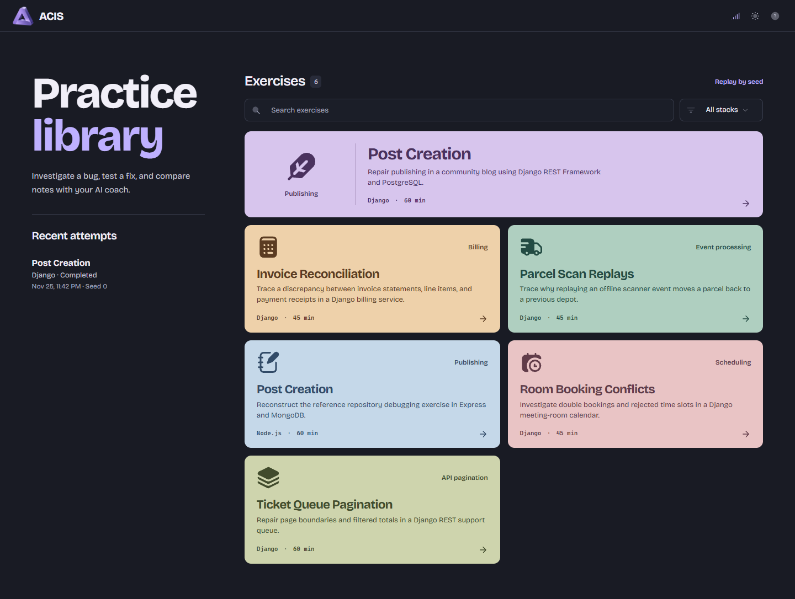

# AI Coding Interview Studio

Practice a timed AI-assisted coding interview in a real browser IDE with editable Django code, PostgreSQL, a terminal, and executable tests.



## Features

- A 60-minute Django REST publishing exercise with three reproducible variants.
- Django exercises in room scheduling, parcel scan retries, invoice reconciliation, and ticket pagination.
- The reference publishing exercise in Node.js and MongoDB.
- Live application previews, real test failures, source changes, and post-interview review.
- An optional coach using your Codex login, OpenAI API key, or Gemini API key.
- File-based problem authoring with a scaffold command and a validator.

## Quick start

Install Node.js 22.16 or newer, Git, and Docker Desktop with a running Linux engine.
On Windows, use its WSL2 backend.
From this checkout, run:

```powershell
npm ci
npm run mock
```

The launcher opens the practice library.
Choose an exercise to prepare its Docker workspace, then select **Begin** when you are ready to start the clock.
Use **Run** to reproduce the issue in the preview and **Run Tests** to check your changes.
Your recent attempts are available from the library.

To open a particular exercise directly, run `npm run mock -- --problem room-booking --seed 42`.

## Docs

- [Practice sessions](docs/practice-sessions.md) covers the timer, controls, local state, and review.
- [Configure the coach](docs/ai-coach.md) covers Codex, OpenAI, Gemini, and model selection.
- [Author a problem](docs/problem-authoring.md) walks through adding, validating, and launching a Django exercise.
