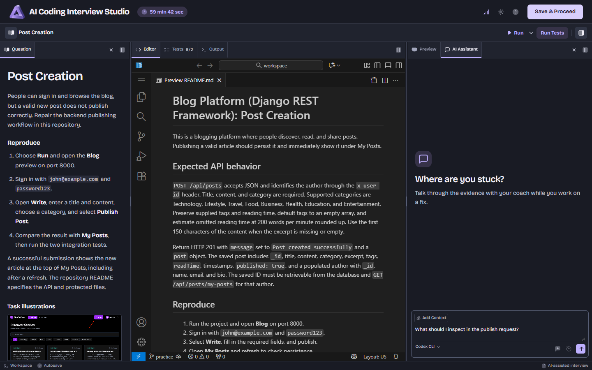

# Practice sessions

ACIS runs a single-user assessment server on loopback and gives each attempt a Linux workbench and its own data in Docker.

## Starting

Run `npm run doctor` to check the Docker engine and Compose.
On Windows the launcher also checks the per-user Docker Desktop installation when the current shell has a stale PATH.
Start Docker Desktop if the engine is unavailable.
The default address is `http://127.0.0.1:4177`.
Set `ACIS_PORT` on the host to choose a different port.

| Command | Result |
| --- | --- |
| `npm run mock` | Open the exercise library. |
| `npm run mock -- --library` | Browse problems and reopen saved attempts. |
| `npm run mock -- --problem blog-node --seed 0` | Reproduce the documented Node.js publishing scenario. |
| `npm run mock -- --problem blog-django --seed 1 --no-open` | Prepare another Django variant and print its local URL. |

Choosing an exercise creates a new attempt and cycles through that pack's variants.
To request a particular starter, pass `--problem` and `--seed` to the launcher.
Select **Resume** to reopen the most recent active interview, or choose a specific session from **Recent attempts**.
The same seed in the same pack version recreates the same starting code with fresh application data.
Opening or preparing an attempt leaves the timer at its full allocation.

## During the interview

**Begin** starts the server-owned deadline.
Closing a tab, restarting the launcher, and resetting the project keep that deadline.
Another tab can take over after the previous editing lease expires.
Taking over disconnects the previous editor and retains the files and running application.

The workbench opens the question, README preview, and coach.

Drag **Preview** onto the **AI Assistant** tab to keep the editor visible while switching between the app and chat.
All six tabs can move between the three panes or change order within a pane.
Drop onto the highlighted insertion line to place a tab precisely.
An empty pane collapses and reappears as a drop target when you drag.
The **Move tab** button at the end of each tab strip offers the same destinations and ordering controls by keyboard or touch.

Drag a divider to resize its two neighboring panes, or focus it and use the Left and Right arrow keys.
The pane menu also lets you maximize a pane, restore it, or **Reset layout**.
ACIS remembers tab positions and pane widths across interviews in this browser.
Each interview opens with Editor selected in its saved pane.
Below 720 pixels wide, use the **Workspace view** switcher to open any of the six views.
Widening the window restores the desktop arrangement.

Use the editor's Explorer, search, Source Control, splits, and Terminal as you would in VS Code.
Open the command palette with Ctrl+Shift+P and use Quick Open with Ctrl+P.
In Django packs, **Run and Debug** can launch a debugging session on internal port 8082.

**Run** starts or restarts the real application.
Run, Run Tests, and Startup output select their tab in whichever pane holds it.
The blog has an API preview on 8080 and its frontend on 8000.
Select the frontend to sign in and exercise the application.
The preview offers navigation, reload, device presets, and custom dimensions.

**Run Tests** saves the editor and grades a snapshot with the pack's declared test command.
The results show assertion details and the terminal output.
Changes after a run mark its result stale.
**Stop All Tests** cancels the running grader.
Tests use separate data from the live preview.

The Help menu can reseed live data or reset the entire project.
A project reset archives the previous workspace and restores the faulty starter.
Protected files are read-only in the editor and their contents are checked during grading.

## Submission and storage

**Save & Proceed** opens the dashboard and lets you resume while time remains.
**Submit Test** or expiry freezes the workspace, grades that snapshot, and opens review.
If the deadline passes while Docker is offline, ACIS retains the saved files and can finish grading after Docker returns.
If the launcher is force-killed while Docker keeps running, ACIS captures the saved files when the launcher restarts.
Review includes the submitted diff, test evidence, elapsed time, instructor debrief, and chat history.
The visible test count is the practice score.

Attempt state, saved source, archives, and review data live under the ignored `.acis` directory.
Each workbench mounts its own candidate workspace and dependencies.
Instructor files and host AI credentials stay outside the container.
Submitting an attempt releases its containers and database volumes while retaining the local review.
Use Ctrl+C in the launcher terminal to stop serving the app.
Run the library command again to return to your attempts.

## Reference

The workbench opens directly into one AI-assisted repository exercise.
The Django version adapts the documented publishing issue to Django REST Framework and PostgreSQL.
The Node version reconstructs the original Express/MongoDB stack.
The room-booking, parcel-scan, and invoice exercises cover separate Django debugging scenarios.
